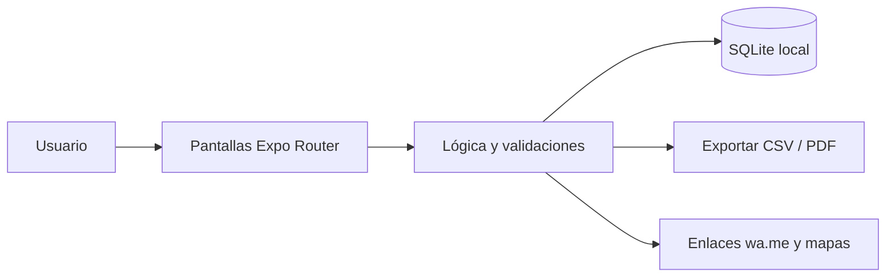

<div align="center">


# FeriaCuenta

**Ventas, compras y ganancia del día para comerciantes de feria y mercado, con teclado grande y sin internet.**

[](LICENSE)
[](https://github.com/LuisRocha2080/FeriaCuenta/actions/workflows/ci.yml)


[Vista rápida](#vista-rápida) · [Características](#características) · [Stack](#stack) · [Roadmap](#roadmap) · [Modelo comercial](#modelo-comercial) · [Inicio rápido](#inicio-rápido) · [Contribuir](#contribuir)

</div>

---

## Vista rápida

| | |
|---|---|
| **Para quién** | Comerciantes de feria, puestos de mercado y vendedores de frutas, verduras y abarrotes |
| **Problema** | El comerciante compra en la madrugada, vende todo el día y cierra sin saber si ganó: el dinero se mezcla con el del hogar y no distingue costo de ganancia. |
| **Solución** | App móvil que funciona sin internet y guarda todo en el teléfono. |
| **Costo de licencias** | Bs 0: Expo, React Native, SQLite y TypeScript son de código abierto. |

## Características

- Venta rápida con botones grandes por producto, por peso o por unidad.
- Registro de compras de mercadería con costo por unidad.
- Gastos del puesto (alquiler, transporte, bolsas, ayudante).
- Cierre del día: ventas, compras, gastos y ganancia estimada.
- Margen por producto para saber qué conviene vender.
- Historial semanal y mensual en gráfico simple.

Sin servidores, sin suscripciones obligatorias y sin servicios de pago: todos los datos viven en el dispositivo (SQLite).

## Stack

| Capa | Tecnología |
|---|---|
| App | React Native + Expo (TypeScript) |
| Datos | SQLite local (`expo-sqlite`) |
| Navegación | Expo Router |
| Pruebas | Jest + `tsc --noEmit` |
| Distribución | APK directo / EAS Build local |

### Modelo de datos

- `productos` (id, nombre, unidad (kg / unidad / atado / caja), precio_venta, costo_ultimo, activo)
- `compras` (id, fecha, producto_id, cantidad, costo_total)
- `ventas` (id, fecha, producto_id, cantidad, monto)
- `gastos` (id, fecha, categoria, monto, nota)
- `cierres` (id, fecha, ventas, compras, gastos, efectivo_contado)

Detalle completo: [docs/DATOS.md](docs/DATOS.md).

## Arquitectura



## Roadmap

1. Base y navegación
2. Productos y venta rápida
3. Compras y gastos
4. Cierre y margen
5. Historial y piloto

Detalle fase por fase: [docs/ROADMAP.md](docs/ROADMAP.md) · [docs/SPEC.md](docs/SPEC.md) · [docs/PLANNING.md](docs/PLANNING.md) · [docs/DATOS.md](docs/DATOS.md) · [docs/PANTALLAS.md](docs/PANTALLAS.md) · [docs/PRUEBAS.md](docs/PRUEBAS.md) · [docs/BACKLOG.md](docs/BACKLOG.md) · [docs/NEGOCIO.md](docs/NEGOCIO.md)

## Modelo comercial

- **Cómo se vende:** Pago único muy bajo con difusión boca a boca, o plan mensual simbólico.
- **Precio de partida:** Hipótesis a validar: Bs 60–100 pago único.
- **Canal:** Visita a ferias barriales y capacitación presencial de 15 minutos por puesto.
- **Piloto:** 5 puestos por 30 días, midiendo cuántos cierran el día con la app y cuántos dicen conocer su ganancia.

Los precios son hipótesis para validar con clientes reales antes de fijarlos. Ver [docs/NEGOCIO.md](docs/NEGOCIO.md).

## Estructura

```
FeriaCuenta/
├── app/            # Pantallas y rutas (Expo Router)
├── src/
│   ├── db/         # Esquema y consultas SQLite
│   ├── components/ # Componentes reutilizables
│   └── lib/        # Utilidades
├── docs/           # Roadmap, specs, planificación, datos, pantallas, pruebas, backlog
└── .github/        # Plantillas, CI y Dependabot
```

## Inicio rápido

Requisitos: Node.js 20+ y la app Expo Go (o un emulador).

```bash
git clone https://github.com/LuisRocha2080/FeriaCuenta.git
cd FeriaCuenta
npm install
npx expo start
```

> El repositorio está en **fase inicial**: la documentación y la estructura están listas y el código de la app se construye siguiendo el [roadmap](docs/ROADMAP.md).

## Pruebas

```bash
npm test
npx tsc --noEmit
```

## Seguridad

Los datos no salen del teléfono. Para reportar una vulnerabilidad lee [SECURITY.md](SECURITY.md).

## Lo que todavía no existe

- El costo de lo vendido se estima con el último costo de compra, no con lotes.
- Sin sincronización entre teléfonos.
- No emite facturas.

## Contribuir

Lee la [guía de contribución](CONTRIBUTING.md) y el [código de conducta](CODE_OF_CONDUCT.md). Para dudas, consulta [SUPPORT.md](SUPPORT.md).

## Licencia

Distribuido bajo licencia MIT. Consulta [LICENSE](LICENSE).

---

<div align="center">Hecho por <a href="https://github.com/LuisRocha2080">LuisRocha2080</a></div>
